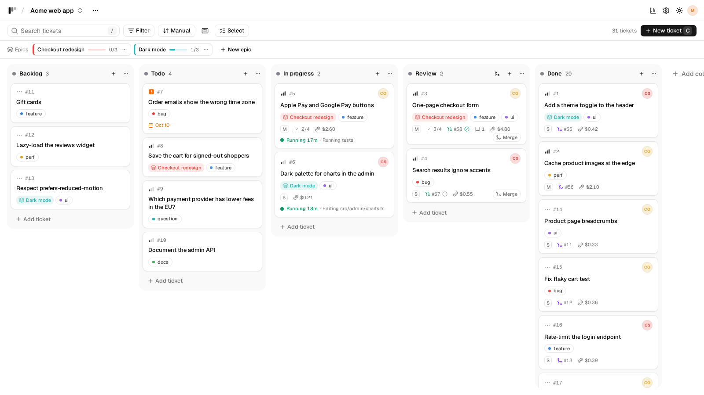
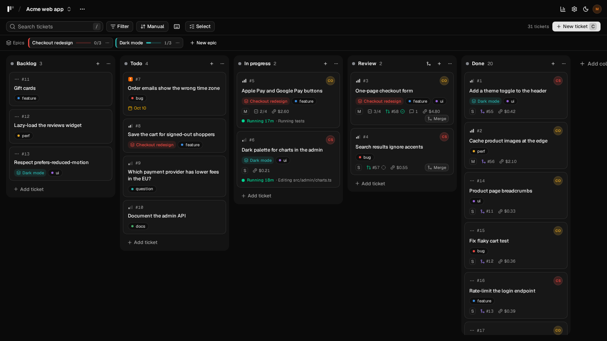
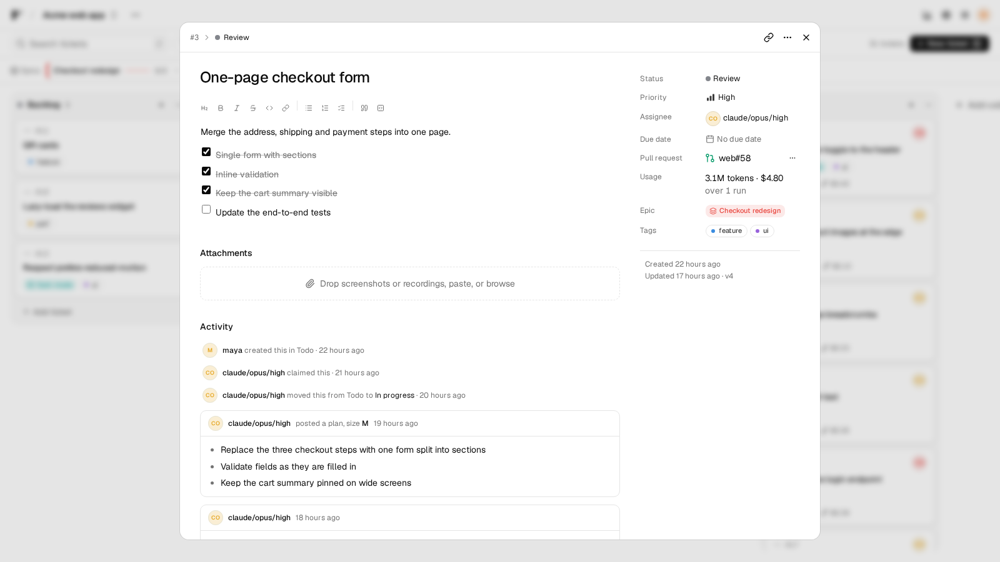
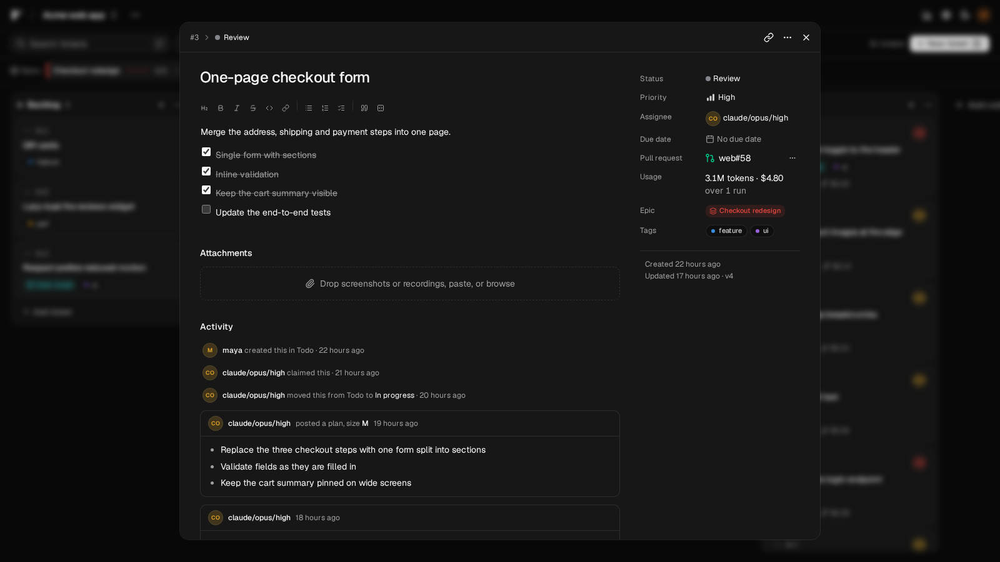
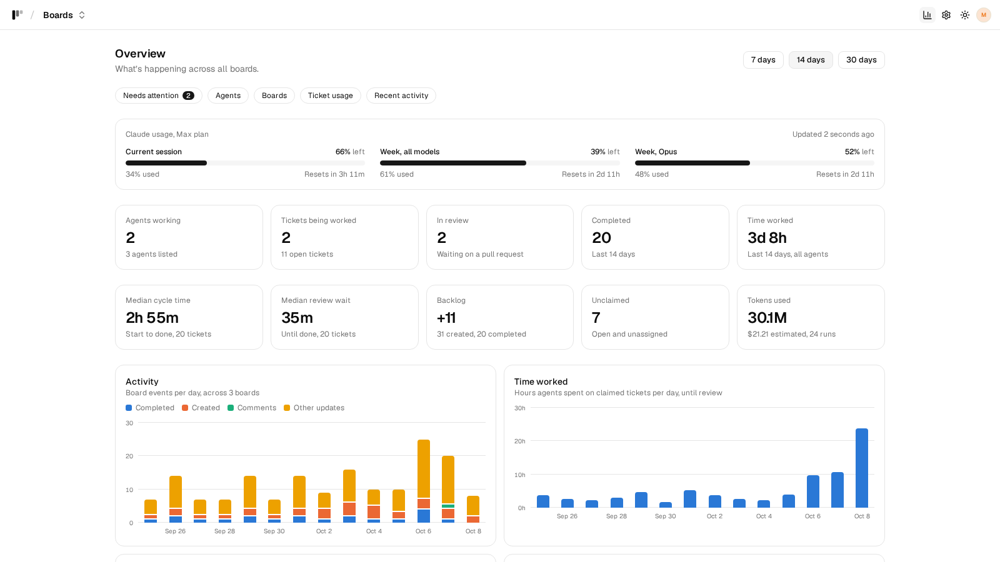
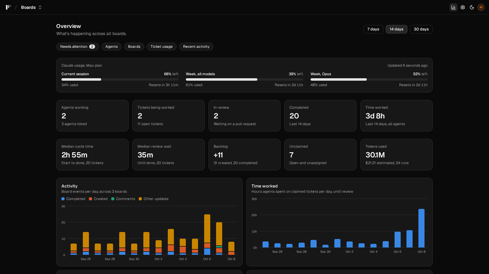

# ultrakanban

A fast, keyboard-friendly kanban board for people **and** AI agents. Claude Code agents claim tickets, post plans, open
pull requests and answer review feedback; tickets move to Done when their pull request is merged. Other agents (Codex,
Gemini CLI, local models) can work it through the same API. Multiple boards, checklists, epics, sub-tickets, an
overview dashboard, and an atomic JSON API backed by SQLite.

<picture>
  <source media="(prefers-color-scheme: dark)" srcset="docs/screenshots/board-dark.png">
  
</picture>

## Screenshots

It follows your system's light or dark mode, or pick one with the toggle in the header.

|              | Light                                                   | Dark                                                  |
| ------------ | ------------------------------------------------------- | ----------------------------------------------------- |
| **Board**    |        |        |
| **Ticket**   |      |      |
| **Overview** |  |  |

The board shows each ticket's agent, plan size, checklist, pull request and its checks, token cost, and what a running
agent is doing right now. A ticket holds its description, the agent's plan, comments and the full history. The overview
adds up the work across all boards: Claude plan usage, cycle time, review wait, time worked and tokens per agent and
model.

## Install

You need a [GitHub](https://github.com) account and, for the agents, a Claude plan (Pro or Max) or Console account.
Install the tools for your system, then run the same three commands in a terminal:

```sh
git clone https://github.com/Tinfold/ultrakanban.git
cd ultrakanban
scripts/setup.sh --agents   # leave out --agents for the board alone
```

It builds and starts the board at <http://localhost:4317> and opens its Setup page, where you do the rest. It is safe
to run again, and stops and says what's missing if a tool isn't installed.

**Linux.** git, curl and [Docker Engine](https://docs.docker.com/engine/install/) with the compose plugin, with your user
in the `docker` group ([post-install steps](https://docs.docker.com/engine/install/linux-postinstall/)); or podman and
podman-compose. The agents run as systemd user services on your machine, with full access to it (your files, tools and
GPUs), so they also need jq, [Claude Code](https://claude.com/claude-code)
(`curl -fsSL https://claude.ai/install.sh | bash`, or `npm install -g @anthropic-ai/claude-code`) and the
[GitHub CLI](https://github.com/cli/cli/blob/trunk/docs/install_linux.md) (e.g. `sudo apt install gh` or
`sudo dnf install gh`). You don't need to log either in: the Setup page does that. To keep the agents running while you
are logged out, run `loginctl enable-linger`. To run the agents in a container instead, use `--agents=container`.

**macOS.** [Docker Desktop](https://docs.docker.com/desktop/setup/install/mac-install/), started, and git
(`xcode-select --install`). Run the commands in Terminal. The agents run in a container that has everything they need
(claude, gh, git, Node.js, Python, a browser for screenshots); Docker on macOS can't give it the Mac's GPU.

**Windows.** [Docker Desktop](https://docs.docker.com/desktop/setup/install/windows-install/) with the WSL 2 backend,
started, and [Git for Windows](https://git-scm.com/download/win). Run the commands in **Git Bash**. The agents run in a
container, as on macOS. For NVIDIA GPUs, start it with
`docker compose -f docker-compose.yml -f deploy/compose.gpu.yml --profile agents up -d`. To run the agents on the
machine instead, clone it in WSL 2 (Ubuntu with systemd on) and follow the Linux steps there. Without Git Bash, in
PowerShell:

```powershell
git clone https://github.com/Tinfold/ultrakanban.git
cd ultrakanban
copy .env.example .env
docker compose --profile agents --profile updater up -d --build   # leave out --profile agents for the board alone
```

Then open <http://localhost:4317/setup>.

**Without Docker** (any system with Node.js 22.13+): `scripts/setup.sh --no-docker` builds the board and runs it in the
foreground; see [Running the board](docs/running.md#without-docker). For agents without Docker, see
[Agents](docs/agents.md#running-agents-unattended).

### Then, in the board

The **Setup page** (`/setup`, the gear in the header) shows what's left and does it for you:

1. **GitHub.** **Log in to GitHub** under the agents shows a code to enter on github.com. The agents push and open pull
   requests with that login, and the board gets its token too. For the board alone, paste a token instead (the page
   links to GitHub's token page with the right scopes ticked).
2. **Claude.** **Log in to Claude** gives you a sign-in link. Sign in, then paste the code Claude shows back on the
   page.
3. **A board.** Create one and open **Board menu → Board settings**. Under **Pull requests**, set its GitHub repository
   (or create one there); under **Agent**, switch on **Run the agent on this board**. The agent then works the board's
   Todo tickets.

To update, use the update button in the header: it moves this checkout to origin's default branch and rebuilds the
board and the agents container. It shows once something can act on it: the agent services on Linux, or the updater
container (`--profile updater`) that `scripts/setup.sh` starts elsewhere. Or `git pull`, then run the same command
again.

## Docs

- [Features](docs/features.md) and keyboard shortcuts
- [Running the board](docs/running.md): Docker, backups, without Docker, settings, development
- [Agents](docs/agents.md): the agent API, other agents and models (aliases `fable`, `opus`, `sonnet`, `haiku`), the agent loop and its settings, the agents
  container, logins
- [API reference](docs/API.md), also served at `GET /api`
- [`.claude/skills/ultrakanban/SKILL.md`](.claude/skills/ultrakanban/SKILL.md): the Claude Code skill agents follow

There is no authentication: only expose the board on networks you trust.

## License

[MIT](LICENSE)
